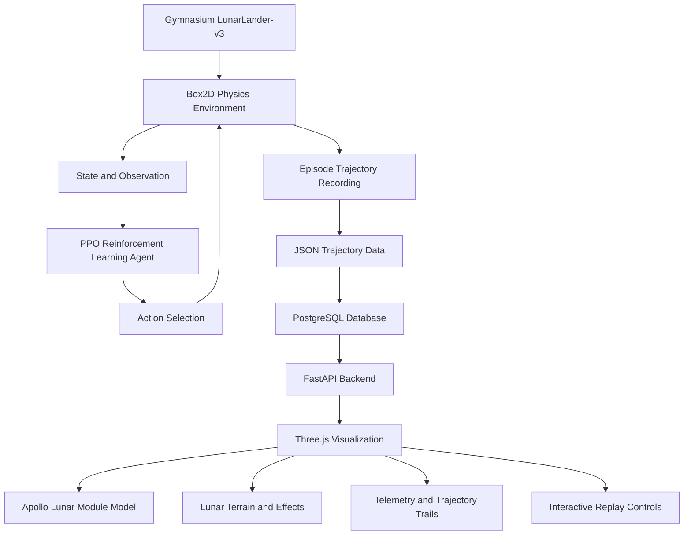
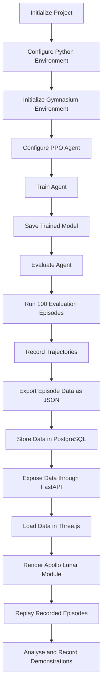
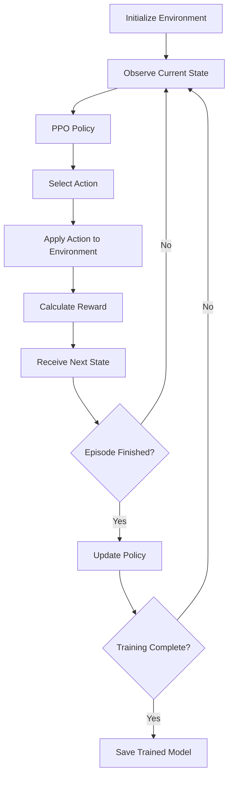
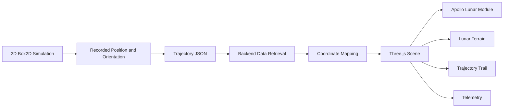
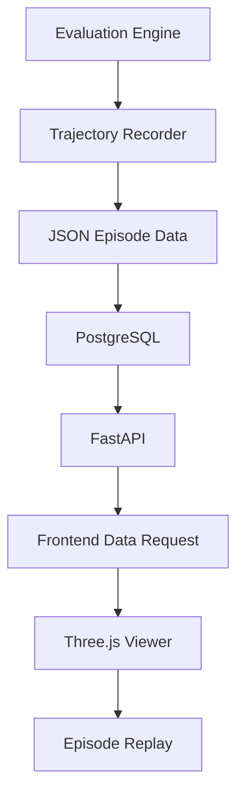

# 🌕 REWO_LANDER
### Reinforcement Learning-Based Autonomous Lunar Landing with 3D Trajectory Visualization

<p align="center">
  <strong>Learn in 2D. Visualize in 3D. Analyse every landing attempt.</strong>
</p>

<p align="center">
  
  
  
  
  
  
  
</p>

---

## 📌 Table of Contents

- [Introduction](#-introduction)
- [Project Vision](#-project-vision)
- [Demonstration](#-demonstration)
- [Key Features](#-key-features)
- [System Architecture](#-system-architecture)
- [End-to-End Pipeline](#-end-to-end-pipeline)
- [Reinforcement Learning Methodology](#-reinforcement-learning-methodology)
- [3D Visualization Architecture](#-3d-visualization-architecture)
- [Technology Stack](#-technology-stack)
- [Repository Structure](#-repository-structure)
- [System Requirements](#-system-requirements)
- [Installation and Project Initialization](#-installation-and-project-initialization)
- [Running the Project](#-running-the-project)
- [Database and Backend Architecture](#-database-and-backend-architecture)
- [Evaluation and Results](#-evaluation-and-results)
- [Limitations](#-limitations)
- [Potential Applications](#-potential-applications)
- [Future Improvements](#-future-improvements)
- [Troubleshooting](#-troubleshooting)
- [Contributing](#-contributing)
- [References](#-references)
- [Author](#-author)

---

## 🚀 Introduction

**REWO_LANDER** is an experimental autonomous lunar landing project that combines Reinforcement Learning, physics-based simulation, backend data management, and interactive 3D visualization.

The project explores how an intelligent agent can learn landing behaviour through repeated interaction with a simulated lunar landing environment.

A **Proximal Policy Optimization (PPO)** agent is trained using Gymnasium's `LunarLander-v3` environment, which uses Box2D physics to simulate the lander's motion, forces, and landing behaviour.

The resulting trajectories are then transformed into a 3D visualization using Three.js and an Apollo Lunar Module 3D model.

The system also incorporates PostgreSQL for trajectory data storage and FastAPI for backend communication.

### The central idea

> **Learn in 2D. Visualize in 3D. Analyse the behaviour.**

The reinforcement learning agent operates in the original 2D physics environment. The 3D viewer reconstructs and displays the recorded trajectories generated by that environment.

This separation allows the project to retain the original simulation behaviour while providing a more intuitive and immersive way to inspect landing attempts.

---

## 🌑 Project Vision

Autonomous landing is a challenging control problem involving several interacting variables:

- Position and velocity.
- Horizontal and vertical movement.
- Angular orientation.
- Angular velocity.
- Engine activation and thrust.
- Landing stability.
- Contact with the landing surface.

REWO_LANDER explores how Reinforcement Learning can be used to develop a control policy through repeated simulated trials.

Rather than manually programming every movement, the agent interacts with the environment, receives rewards or penalties, and gradually updates its policy.

The project is intended as an educational and experimental foundation for exploring autonomous control systems.

---

## 🎥 Demonstration

The project includes a browser-based 3D visualization of recorded lunar landing episodes.

**To watch the video demonstration:**

1. Visit my LinkedIn profile.
2. Find the post related to **REWO_LANDER**.
3. Check the attached video demonstration to see the 3D lunar landing replay.

🔗 **LinkedIn Profile:**  
https://www.linkedin.com/in/jay-keluskar-b17601358/

🔗 **GitHub Repository:**  
https://github.com/Jayz-yuors/REWO-LANDER

---

## ✨ Key Features

| Feature | Description |
|---|---|
| Reinforcement Learning | PPO-based autonomous landing agent |
| Physics Environment | Gymnasium LunarLander-v3 with Box2D |
| Trajectory Recording | Stores actual simulation episode data |
| 3D Visualization | Three.js-based lunar landing viewer |
| Apollo Lunar Module | 3D lander model integrated into the visualization |
| Lunar Terrain | Visual representation of the lunar surface |
| Telemetry | Displays trajectory and movement information |
| Trajectory Trails | Visualizes the lander's movement path |
| PostgreSQL | Persistent storage for recorded episode data |
| FastAPI | Backend API layer |
| Replay Controls | Play, pause, step, seek, and playback speed |
| Camera Controls | Follow and wide camera modes |
| Automated Replay | Sequential playback of recorded episodes |
| Video Recording | Browser-based recording using MediaRecorder |

---

## 🏗️ System Architecture

The architecture is divided into four major layers:

1. **Simulation Layer** – Executes the physics environment.
2. **Learning Layer** – Trains and evaluates the PPO agent.
3. **Data and Backend Layer** – Records, stores, and serves episode information.
4. **Visualization Layer** – Reconstructs the recorded trajectories in a 3D browser environment.

### High-Level Architecture



### Important Architectural Distinction

The simulation and visualization layers have different responsibilities.

**Simulation layer:**
- Uses Gymnasium and Box2D.
- Calculates the lander's actual 2D movement.
- Processes actions and environment transitions.
- Generates the trajectory data.

**Visualization layer:**
- Reads recorded simulation trajectories.
- Maps recorded motion into a 3D scene.
- Displays the lander, terrain, trails, and telemetry.
- Provides interactive replay controls.

The Three.js scene does not independently calculate or replace the original Box2D physics.

---

## 🔄 End-to-End Pipeline

The complete workflow follows this sequence:



### Pipeline Breakdown

| Stage | Component | Responsibility |
|---|---|---|
| 01 | Environment Initialization | Creates the lunar landing environment |
| 02 | Agent Configuration | Configures the PPO policy |
| 03 | Training | Learns a landing strategy |
| 04 | Model Saving | Saves the trained policy |
| 05 | Evaluation | Tests the trained agent |
| 06 | Trajectory Recording | Captures episode-level movement |
| 07 | Data Export | Organizes recorded trajectories |
| 08 | Database | Stores episode data |
| 09 | Backend | Provides data through API endpoints |
| 10 | Visualization | Reconstructs trajectories in 3D |
| 11 | Replay | Allows interactive inspection |
| 12 | Demonstration | Records the visualization for presentation |

---

## 🧠 Reinforcement Learning Methodology

### 1. Environment

The project uses:

`Gymnasium: LunarLander-v3`

The environment simulates a lunar landing task using Box2D physics.

The agent must learn to control the lander while considering its position, velocity, orientation, and contact with the landing surface.

### 2. Algorithm: Proximal Policy Optimization

The project uses **PPO (Proximal Policy Optimization)**, a policy-gradient reinforcement learning algorithm.

PPO updates the policy while restricting excessively large changes between policy updates.

This helps stabilize policy optimization during training.

### 3. Learning Loop



### 4. State and Action Concept

The LunarLander environment provides observations representing information such as:

- Horizontal position.
- Vertical position.
- Horizontal velocity.
- Vertical velocity.
- Angular orientation.
- Angular velocity.
- Left landing-leg contact.
- Right landing-leg contact.

The discrete action space contains four possible actions:

| Action | Behaviour |
|---|---|
| 0 | Do nothing |
| 1 | Fire left orientation engine |
| 2 | Fire main engine |
| 3 | Fire right orientation engine |

The agent learns which action to select based on its observations and the reward structure of the environment.

### 5. Reward-Based Learning

The environment provides rewards based on the lander's behaviour.

The learning objective is to discover a policy that improves landing performance while accounting for movement, stability, and landing conditions.

The exact reward accumulated depends on the episode's trajectory and outcome.

---

## 🌌 3D Visualization Architecture

One of the central components of REWO_LANDER is its 3D visualization layer.

Instead of displaying only the original 2D environment, the project reconstructs the recorded trajectory in a browser-based 3D scene.

### Visualization Components

- Apollo Lunar Module 3D model.
- Lunar terrain representation.
- Engine and visual effects.
- Trajectory trails.
- Movement telemetry.
- Interactive camera controls.
- Episode replay interface.

### 2D-to-3D Data Flow



### Why This Approach?

The approach separates physical simulation from visual representation.

It allows the original 2D environment to remain the source of the lander's simulated behaviour, while the 3D viewer provides an alternative way to inspect the same recorded events.

This makes it possible to study trajectories in a more visually intuitive environment without claiming that the agent has been trained in a 3D physics engine.

### Interactive Replay Controls

The browser viewer includes:

| Control | Function |
|---|---|
| Play | Starts episode playback |
| Pause | Pauses the current episode |
| Step | Advances through the trajectory |
| Seek | Moves to a selected point in the episode |
| Speed | Changes playback speed |
| Follow | Tracks the lander with the camera |
| Wide | Displays a wider scene view |
| Trail | Displays the trajectory path |
| Episode Queue | Manages sequential episode playback |

The viewer also supports browser-based video recording through the MediaRecorder API.

---

## 🛠️ Technology Stack

| Category | Technologies |
|---|---|
| Programming Language | Python |
| Reinforcement Learning | Stable-Baselines3 |
| RL Algorithm | Proximal Policy Optimization |
| Simulation Environment | Gymnasium |
| Physics Engine | Box2D |
| Deep Learning Framework | PyTorch |
| Backend Framework | FastAPI |
| Database | PostgreSQL |
| Data Format | JSON |
| 3D Visualization | Three.js |
| 3D Asset | Apollo Lunar Module GLB model |
| Frontend | HTML, CSS, JavaScript |
| Browser Recording | MediaRecorder API |
| Version Control | Git and GitHub |

---

## 📁 Repository Structure

The repository is organized into the following major components:

```text
REWO_LANDER/
│
├── .gitignore
├── README.md
├── README_APOLLO_3D_FIX.md
│
├── db_config.py
│
├── phase_0.py
│
├── test_thrusters.py
│
├── models/
│   └── Trained models and model-related assets
│
├── results/
│   └── Evaluation results and recorded trajectories
│
├── scripts/
│   └── Training, evaluation, and utility scripts
│
├── src/
│   └── Core simulation, learning, and application modules
│
├── visualizer/
│   └── Visualization-related components
│
└── web/
    └── Browser-based 3D visualization interface
```

> **Note:** This is a high-level representation of the repository. Individual filenames and subdirectories may vary as the project evolves.

### Main Components

**`phase_0.py`**
- Initial project phase / entry-point script.
- Refer to the script itself for its exact execution responsibilities.

**`models/`**
- Stores model-related files and trained agent artifacts.

**`results/`**
- Stores evaluation outputs and recorded episode information.

**`scripts/`**
- Contains utility and execution scripts.

**`src/`**
- Contains the core project implementation.

**`visualizer/`**
- Contains visualization-related implementation.

**`web/`**
- Contains the browser-based visualization interface.

**`db_config.py`**
- Contains database connection configuration.

**`test_thrusters.py`**
- Contains thruster-related testing code.

---

## 💻 System Requirements

### Recommended Software

| Requirement | Details |
|---|---|
| Operating System | Windows / Linux |
| Python | Python 3.10+ recommended |
| Package Manager | pip |
| Database | PostgreSQL |
| Browser | Modern Chromium-based browser or equivalent |
| Version Control | Git |
| Frontend | JavaScript-enabled browser |

### Hardware Considerations

The project can be explored on CPU-based systems, although training time depends on the processor, environment configuration, and number of training steps.

For larger experiments, additional CPU resources and memory may be beneficial.

---

## ⚙️ Installation and Project Initialization

Follow these steps to set up the project locally.

### Step 1: Clone the Repository

```bash
git clone https://github.com/Jayz-yuors/REWO-LANDER.git
```

Navigate into the project:

```bash
cd REWO-LANDER
```

### Step 2: Create a Virtual Environment

**Windows PowerShell:**

```powershell
python -m venv venv
```

Activate the environment:

```powershell
.\venv\Scripts\Activate.ps1
```

If PowerShell blocks activation, use:

```powershell
Set-ExecutionPolicy -Scope Process -ExecutionPolicy Bypass
.\venv\Scripts\Activate.ps1
```

**Linux / macOS:**

```bash
python3 -m venv venv
source venv/bin/activate
```

### Step 3: Upgrade pip

```bash
python -m pip install --upgrade pip
```

### Step 4: Install Dependencies

If the repository contains a `requirements.txt` file:

```bash
pip install -r requirements.txt
```

If dependencies are not yet maintained in a requirements file, install the relevant packages individually:

```bash
pip install gymnasium[box2d]
pip install stable-baselines3
pip install torch
pip install numpy
pip install pandas
pip install matplotlib
pip install fastapi
pip install "uvicorn[standard]"
pip install psycopg2-binary
pip install python-dotenv
```

For browser-based visualization, the web dependencies should be installed according to the package configuration inside the `web/` directory, if present.

> **Dependency note:** Use the versions tested with your project when preparing a reproducible release. The commands above provide a starting point, not a guarantee that every dependency version is identical to the original development environment.

### Step 5: Configure Environment Variables

If your database configuration uses environment variables, create a local `.env` file.

Example:

```env
DB_HOST=localhost
DB_PORT=5432
DB_NAME=rewo_lander
DB_USER=postgres
DB_PASSWORD=your_local_password
```

Do not commit real passwords, API keys, or other credentials to GitHub.

The actual variable names must match the configuration expected by `db_config.py`.

### Step 6: Initialize PostgreSQL

Install and start PostgreSQL if it is not already available.

Create a database:

```sql
CREATE DATABASE rewo_lander;
```

Configure the connection parameters in the project's database configuration.

If the project uses a schema initialization script, execute that script against the newly created database.

---

## ▶️ Running the Project

The project contains multiple execution components. Run them according to their dependencies.

### 1. Verify the Environment

```powershell
python --version
pip list
```

Check whether the main packages import successfully:

```powershell
python -c "import gymnasium, torch; import stable_baselines3; print('Environment ready')"
```

### 2. Test the LunarLander Environment

A minimal environment check:

```python
import gymnasium as gym

env = gym.make("LunarLander-v3")

observation, info = env.reset(seed=42)

print("Initial observation:", observation)
print("Action space:", env.action_space)
print("Observation space:", env.observation_space)

env.close()
```

Save this as a temporary test script and run:

```bash
python test_environment.py
```

### 3. Train the PPO Agent

Run the training script provided in the `scripts/` or `src/` directory.

For example, if your training entry point is named `train.py`:

```bash
python scripts/train.py
```

Replace this example with the actual training entry-point filename in your checkout.

The training process should:
- Initialize the environment.
- Configure the PPO policy.
- Run the learning process.
- Save the trained model.
- Produce training logs or related outputs, depending on the implementation.

### 4. Evaluate the Trained Agent

Run the evaluation entry point from the project.

For example, if the evaluation script is named `evaluate.py`:

```bash
python scripts/evaluate.py
```

The evaluation process tests the saved policy over multiple episodes and records the resulting performance.

### 5. Generate Trajectory Data

Run the trajectory-recording component after loading the trained model.

The expected data flow is:

```text
Trained PPO Model
       |
       v
Evaluation Environment
       |
       v
Episode Execution
       |
       v
State and Action Recording
       |
       v
Trajectory JSON
       |
       v
Database Storage
```

The exact execution command depends on the trajectory-recording script included in the repository.

### 6. Start the Backend

Start the FastAPI application using the actual import path of the FastAPI application object.

General command format:

```bash
uvicorn <module_name>:<app_variable> --reload
```

For example, if the application is exposed as `app` inside `api.py`:

```bash
uvicorn api:app --reload
```

Open the interactive API documentation at:

```text
http://127.0.0.1:8000/docs
```

The exact module name and routes should be verified against the backend source code.

### 7. Start the 3D Visualization

Navigate into the `web/` directory:

```bash
cd web
```

If it contains a Node.js `package.json`, install its dependencies:

```bash
npm install
```

Then use the start script defined in `package.json`, for example:

```bash
npm run dev
```

Open the local URL printed by the development server.

If the viewer is served through a different mechanism, follow the instructions in the `web/` directory.

---

## 🗄️ Database and Backend Architecture

REWO_LANDER uses PostgreSQL and FastAPI as part of its trajectory data pipeline.

### Database Responsibilities

- Store recorded episode information.
- Persist trajectory data for later retrieval.
- Support access to previously evaluated episodes.
- Provide data to the visualization layer through the backend.

### Backend Responsibilities

- Establish communication between the database and frontend.
- Retrieve recorded episode information.
- Provide data to the browser-based viewer.
- Support the trajectory replay workflow.

### Data Flow



The actual database tables, API endpoints, and request/response schemas should be consulted in the source code.

---

## 📊 Evaluation and Results

The current experimental evaluation was conducted over **100 episodes**.

| Metric | Current Result |
|---|---:|
| Total Evaluation Episodes | 100 |
| Successful Landings | 10 |
| Landing Success Rate | 10% |

### Success Rate

\[
\text{Success Rate} =
\frac{\text{Successful Landings}}
{\text{Total Evaluation Episodes}}
\times 100
\]

\[
= \frac{10}{100}\times100 = 10\%
\]

### Interpretation

The current evaluation indicates that the trained agent can achieve successful landings in some episodes, but its performance is not yet reliable.

The result should be treated as an experimental baseline rather than evidence of a mature autonomous landing controller.

The recorded episodes also provide useful material for inspecting:
- Trajectory behaviour.
- Landing attempts.
- Control decisions.
- Stability issues.
- Differences between successful and unsuccessful episodes.

---

## ⚠️ Limitations

REWO_LANDER is an experimental simulation and visualization project.

The following limitations are important:

1. **2D simulation:** The agent is trained in the 2D Gymnasium LunarLander-v3 environment.
2. **3D visualization:** The Three.js scene visualizes recorded 2D simulation trajectories; it does not implement an independent 3D physics engine.
3. **Experimental performance:** The current measured landing success rate is 10% over 100 evaluation episodes.
4. **Simplified environment:** The simulated environment does not represent the complete complexity of a real lunar landing mission.
5. **No flight qualification:** The system is not validated for real spacecraft operation and is not flight-ready.

Results from this project should not be interpreted as proof of real-world lunar landing capability.

---

## 🔭 Potential Applications

The project provides a foundation for exploring concepts relevant to:

- Lunar and planetary exploration research.
- Autonomous robotics.
- Reinforcement Learning for control systems.
- Trajectory analysis and visualization.
- Simulation-based AI experimentation.
- Aerospace engineering education.
- Autonomous navigation research.

These are potential research directions, not validated operational applications.

---

## 🚧 Future Improvements

Possible directions for extending REWO_LANDER include:

### Reinforcement Learning
- Improve PPO hyperparameter selection.
- Experiment with alternative reward functions.
- Compare PPO with SAC, TD3, and DQN where appropriate.
- Increase training duration.
- Study training stability across random seeds.
- Improve landing success rate and consistency.

### Simulation
- Investigate more realistic environmental disturbances.
- Explore additional landing conditions.
- Introduce variations in initial states.
- Study robustness under different simulation settings.

### Visualization
- Improve 3D trajectory mapping.
- Add more detailed telemetry panels.
- Compare multiple episodes.
- Improve visual analysis of unsuccessful landings.
- Add richer trajectory inspection tools.

### Backend and Data
- Improve episode indexing and retrieval.
- Add performance analytics.
- Support comparison between training runs.
- Improve database schema and API documentation.

### Research Extensions
- Explore domain randomization.
- Investigate transfer from simplified environments to more complex simulators.
- Study sim-to-sim transfer.
- Explore 3D physics environments as a separate future research direction.

---

## 🧰 Troubleshooting

### Box2D Installation Issues

Try:

```bash
pip install "gymnasium[box2d]"
```

If installation fails, verify your Python version and platform-specific build dependencies.

### Module Not Found

Ensure the virtual environment is activated:

```powershell
.\venv\Scripts\Activate.ps1
```

Then install the missing dependency.

### PostgreSQL Connection Error

Verify:
- PostgreSQL service is running.
- Database exists.
- Host and port are correct.
- Username and password match.
- Database configuration uses the correct environment variables.

### FastAPI Server Error

Verify that:
- The correct Python environment is active.
- FastAPI and Uvicorn are installed.
- The application module and ASGI variable names are correct.
- Database connectivity is available if required at startup.

### 3D Model Not Loading

Verify:
- The GLB asset exists.
- The model path is correct.
- The browser can access the asset.
- The browser console does not report a loading or CORS error.

### Frontend Cannot Retrieve Episode Data

Verify:
- The backend is running.
- The API URL is correct.
- The required endpoint exists.
- PostgreSQL contains the expected episode records.
- The frontend request matches the backend response format.

---

## 🤝 Contributing

Contributions, suggestions, and technical discussions are welcome.

Potential contribution areas include:

- Reinforcement Learning experiments.
- Training optimization.
- Simulation improvements.
- Data pipeline improvements.
- 3D visualization enhancements.
- Documentation and testing.

### Contribution Workflow

1. Fork the repository.
2. Create a new branch.
3. Implement your changes.
4. Test the changes.
5. Submit a pull request with a clear description.

```bash
git clone https://github.com/Jayz-yuors/REWO-LANDER.git

cd REWO-LANDER

git checkout -b feature/your-feature-name
```

---

## 📚 References

1. **Gymnasium Documentation**  
   https://gymnasium.farama.org/

2. **Gymnasium LunarLander Environment**  
   https://gymnasium.farama.org/environments/box2d/lunar_lander/

3. **Stable-Baselines3 Documentation**  
   https://stable-baselines3.readthedocs.io/

4. **Proximal Policy Optimization Paper**  
   https://arxiv.org/abs/1707.06347

5. **FastAPI Documentation**  
   https://fastapi.tiangolo.com/

6. **PostgreSQL Documentation**  
   https://www.postgresql.org/docs/

7. **Three.js Documentation**  
   https://threejs.org/docs/

---

## 👨‍💻 Author

### Jay Keluskar

Computer Engineering Student | AI/ML | Reinforcement Learning | Software Development

**GitHub:**  
https://github.com/Jayz-yuors

**LinkedIn:**  
https://www.linkedin.com/in/jay-keluskar-b17601358/

### Explore REWO_LANDER

🔗 **GitHub Repository:**  
https://github.com/Jayz-yuors/REWO-LANDER

🎥 **Video Demonstration:**  
Visit my LinkedIn profile and check the post related to REWO_LANDER for the project demonstration.

---

<p align="center">
  <strong>🌕 REWO_LANDER</strong>
  <br />
  <em>From 2D Reinforcement Learning to 3D Lunar Trajectory Visualization.</em>
  <br /><br />
  Built to explore the intersection of AI, simulation, and autonomous systems.
</p>
