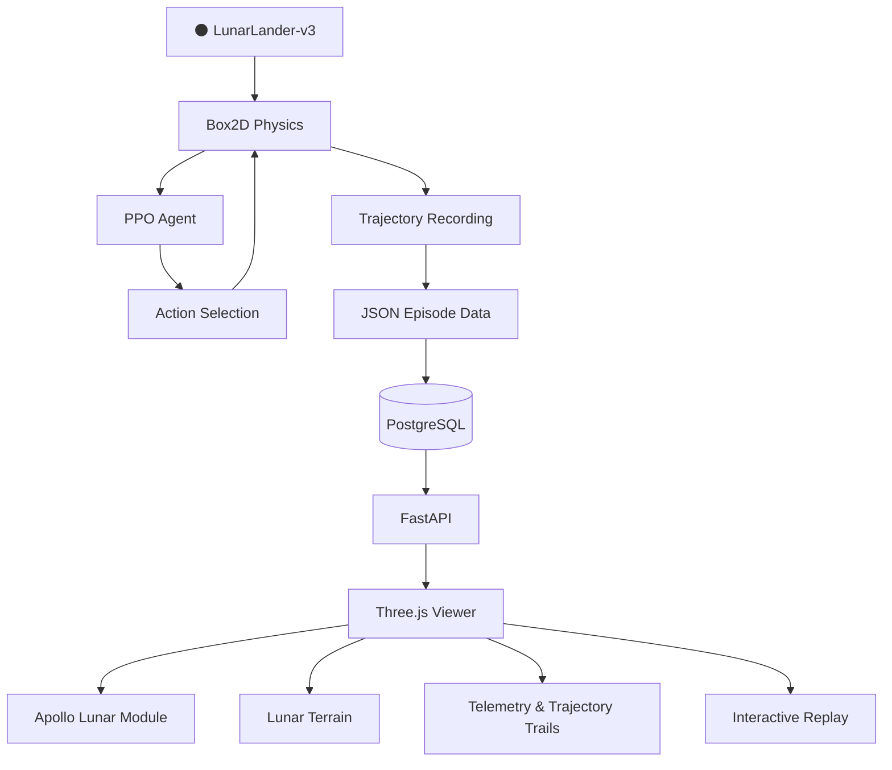
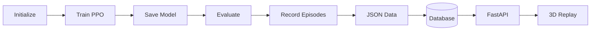
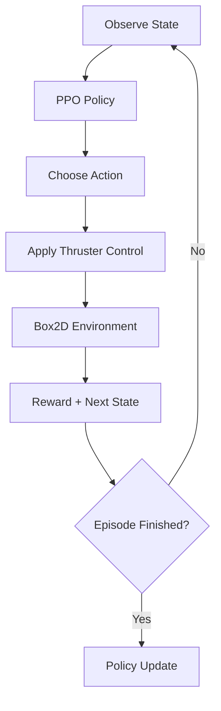
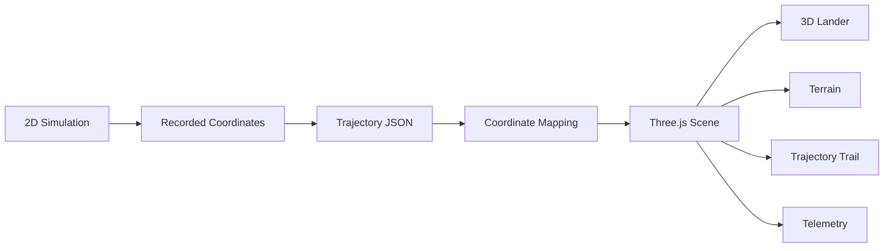

<div align="center">

# 🌕 REWO_LANDER

### 𝑨𝒖𝒕𝒐𝒏𝒐𝒎𝒐𝒖𝒔 𝑳𝒖𝒏𝒂𝒓 𝑳𝒂𝒏𝒅𝒊𝒏𝒈 | 𝑹𝑳 × 𝑺𝒊𝒎𝒖𝒍𝒂𝒕𝒊𝒐𝒏 × 𝟑𝑫

**Learn in 2D. Visualize in 3D. Analyse every landing.**

An experimental Reinforcement Learning system that trains an autonomous lunar lander using PPO and transforms its recorded trajectories into an interactive 3D visualization.

<br/>

[](https://python.org/)
[](https://gymnasium.farama.org/)
[](https://arxiv.org/abs/1707.06347)
[](https://threejs.org/)
[](https://fastapi.tiangolo.com/)
[](https://postgresql.org/)

<br/>

**[GitHub Repository](https://github.com/Jayz-yuors/REWO-LANDER) · [LinkedIn Profile](https://www.linkedin.com/in/jay-keluskar-b17601358/)**

</div>

---

## 🌑 Overview

**REWO_LANDER** explores autonomous lunar landing through Reinforcement Learning.

A **Proximal Policy Optimization (PPO)** agent learns landing behaviour inside Gymnasium's `LunarLander-v3`, powered by Box2D physics. Its actual 2D simulation trajectories are recorded, stored, and reconstructed in a browser-based Three.js environment featuring an Apollo Lunar Module.

The result is a pipeline connecting intelligent control, simulation data, backend infrastructure, and immersive visualization.

> **Important:** The agent operates in a 2D Box2D environment. Three.js provides a 3D visualization of recorded trajectories, not an independent 3D physics simulation.

---

## 🚀 The System at a Glance

<div align="center">

| 🧠 Learning | ⚙️ Simulation | 🌌 Visualization | 🗄️ Infrastructure |
|:---:|:---:|:---:|:---:|
| PPO Agent | Gymnasium + Box2D | Three.js | PostgreSQL |
| Policy Learning | LunarLander-v3 | Apollo Lunar Module | FastAPI |

</div>

## 🏗️ Architecture



## 🔄 End-to-End Pipeline



| Stage | What Happens |
|:---|:---|
| 01 · Train | PPO learns through repeated environment interactions |
| 02 · Evaluate | The trained agent is tested across 100 episodes |
| 03 · Record | Episode trajectories are captured |
| 04 · Store | Trajectory information is stored in PostgreSQL |
| 05 · Serve | FastAPI provides the backend data layer |
| 06 · Visualize | Three.js reconstructs the recorded motion in 3D |

---

## 🧠 Reinforcement Learning

**Algorithm:** Proximal Policy Optimization (PPO)

**Environment:** Gymnasium `LunarLander-v3`

**Physics:** Box2D

The agent observes the lander's state and selects actions to control its movement and landing behaviour.



**Observation includes:** Position, velocity, angle, angular velocity, and landing-leg contact information.

**Actions include:** No operation, left engine, main engine, and right engine.

---

## 🌌 3D Visualization

The recorded simulation trajectories are mapped into a Three.js scene.

**Visualization highlights:**

- 🚀 Apollo Lunar Module 3D model
- 🌕 Lunar terrain and engine effects
- 📍 Trajectory trails and movement telemetry
- 🎥 Play, pause, step and seek controls
- ⚡ Adjustable playback speed
- 🎯 Follow and wide camera modes
- 🔁 Sequential episode replay
- 📹 Browser-based video recording



---

## 📊 Experimental Results

<details>
<summary><strong>Current Evaluation — 100 Episodes</strong></summary>

<br/>

| Metric | Result |
|:---|---:|
| Evaluation Episodes | 100 |
| Successful Landings | 10 |
| Success Rate | **10%** |

```text
Successful Landings    █░░░░░░░░░  10%
Unsuccessful Episodes  █████████░  90%
```

The current model establishes an experimental baseline. Improving landing reliability and policy performance remains a major objective.

</details>

---

## 🛠️ Tech Stack

| Domain | Tools |
|:---|:---|
| Language | Python |
| Reinforcement Learning | Stable-Baselines3 · PPO |
| Simulation | Gymnasium · Box2D |
| ML Framework | PyTorch |
| Backend | FastAPI |
| Database | PostgreSQL |
| Visualization | Three.js · JavaScript |
| 3D Asset | Apollo Lunar Module GLB |
| Data | JSON |
| Version Control | Git · GitHub |

---

## 📂 Project Structure

```text
REWO_LANDER/
│
├── models/          # Trained models and assets
├── results/         # Evaluation and trajectory data
├── scripts/         # Execution and utility scripts
├── src/             # Core implementation
├── visualizer/      # Visualization components
├── web/             # Three.js browser interface
│
├── db_config.py     # Database configuration
├── phase_0.py       # Initial project phase
├── test_thrusters.py
├── README.md
└── .gitignore
```

---

## ⚡ Getting Started

### 1. Clone the Repository

```bash
git clone https://github.com/Jayz-yuors/REWO-LANDER.git
cd REWO-LANDER
```

### 2. Create a Virtual Environment

**Windows PowerShell**

```powershell
python -m venv venv
.\venv\Scripts\Activate.ps1
```

**Linux / macOS**

```bash
python3 -m venv venv
source venv/bin/activate
```

### 3. Install Dependencies

```bash
python -m pip install --upgrade pip

pip install gymnasium[box2d]
pip install stable-baselines3 torch
pip install numpy pandas matplotlib
pip install fastapi "uvicorn[standard]"
pip install psycopg2-binary python-dotenv
```

If a project `requirements.txt` is available, prefer:

```bash
pip install -r requirements.txt
```

### 4. Initialize PostgreSQL

Create the database:

```sql
CREATE DATABASE rewo_lander;
```

Configure your local database credentials according to `db_config.py`. Keep passwords and secrets out of version control.

### 5. Run the Components

| Component | Execution |
|:---|:---|
| Training | Run the training entry point in `scripts/` or `src/` |
| Evaluation | Run the evaluation entry point |
| Backend | `uvicorn <module>:<app> --reload` |
| Frontend | Run the web development command defined in `web/package.json` |

**Note:** Replace the example entry points with the actual script and module names in the repository.

---

## 🎯 Potential Research Directions

- Autonomous lunar and planetary exploration
- Reinforcement Learning for control systems
- Robotics and autonomous navigation
- Simulation-based AI experimentation
- Trajectory analysis and visualization
- Sim-to-sim transfer and more realistic physics environments

## 🚧 Limitations & Future Scope

**Current limitations**
- Training is performed in a simplified 2D environment.
- The 3D layer is a trajectory visualization, not a physics simulator.
- Current evaluation success rate is 10%.
- The system is not flight-ready or validated for real spacecraft operation.

**Future improvements**
- PPO hyperparameter and reward optimization.
- Improved landing stability and success rate.
- More robust evaluation across random seeds.
- Enhanced telemetry and episode analytics.
- Exploration of more realistic simulation environments.

---

## 🎥 See It in Action

<div align="center">

### Want to see the lander in motion?

**Visit my LinkedIn profile and check the REWO_LANDER project post for the video demonstration.**

[](https://www.linkedin.com/in/jay-keluskar-b17601358/)

</div>

---

## 👨‍💻 Author

<div align="center">

### Jay Keluskar

Computer Engineering | AI/ML | Reinforcement Learning | Software Development

[](https://github.com/Jayz-yuors)
[](https://www.linkedin.com/in/jay-keluskar-b17601358/)

**REWO_LANDER — From 2D Reinforcement Learning to 3D Lunar Visualization.** 🌕

</div>
